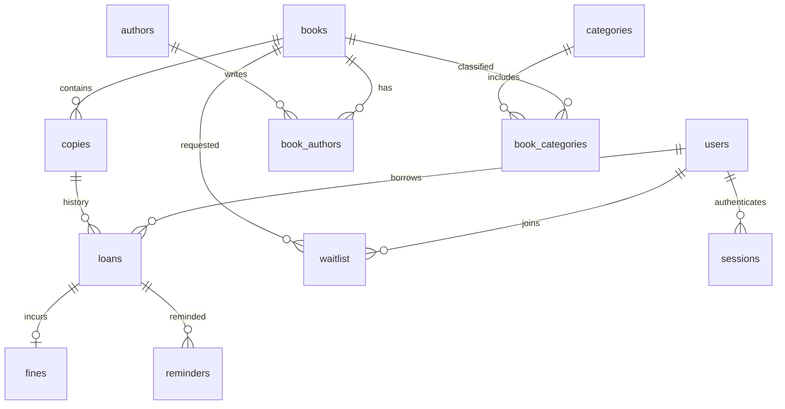
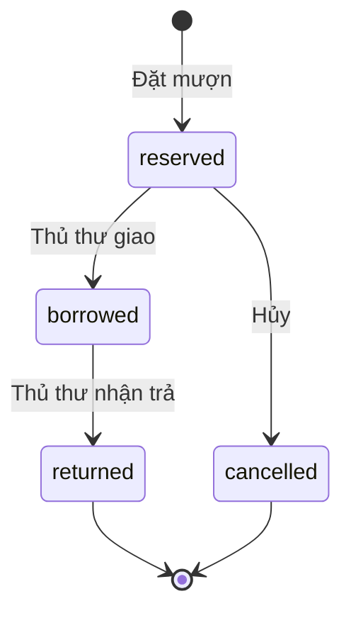

# Thiết kế CSDL mới — Thư viện số Khoa CNTT

Không kế thừa tài liệu hay CSDL cũ. SQLite cho bản thử nghiệm một máy chủ. Migration: `migrations/001_initial.sql`.

| Bảng | Thuộc tính và ràng buộc chính |
|---|---|
| users | id PK; email UNIQUE; name; password_hash; role reader/librarian |
| sessions | token_hash PK; user_id FK; expires_at; chỉ lưu SHA-256 của token ngẫu nhiên |
| books | id PK; title; description; cover_url |
| copies | id PK; book_id FK; barcode UNIQUE; retired boolean |
| authors, categories | id PK; name UNIQUE |
| book_authors | PK kép (book_id, author_id), hai FK |
| book_categories | PK kép (book_id, category_id), hai FK |
| loans | id PK; user_id, copy_id FK; status; reserved_at; borrowed_at; due_date; returned_at; daily_fine |
| fines | id PK; loan_id FK UNIQUE; amount >= 0; paid_at nullable |
| waitlist | id PK; user_id, book_id FK; created_at; UNIQUE(user_id,book_id) |
| reminders | PK (loan_id,day); sent_at; dấu gửi thành công theo ngày |

Một phiếu mượn tương ứng một bản sách. Mượn ba cuốn tạo ba phiếu. Sinh viên và giảng viên dùng chung vai trò `reader`; chưa cần bảng loại bạn đọc vì quy định hiện tại giống nhau.

Số bản còn được tính từ copies chưa thanh lý và không có loan đang reserved/borrowed, không lưu bộ đếm dễ sai lệch. Unique index có điều kiện ngăn hai loan hoạt động trên cùng copy. Mọi thao tác ghi dùng `BEGIN IMMEDIATE`, do đó kiểm tra giới hạn và giữ sách không bị tranh chấp giữa các request trong cùng CSDL SQLite. Giới hạn ba cuốn được bảo vệ tại service, không phải trigger; không sửa trực tiếp bảng loans ngoài ứng dụng.

- reserved + borrowed <= 3 cho mỗi bạn đọc. Hàng đợi không chiếm suất mượn.
- Hạn trả = ngày giao sách + LOAN_DAYS, dùng Asia/Ho_Chi_Minh. Trả trong ngày hạn không bị phạt.
- Ngày quá hạn = max(0, ngày trả/ngày hiện tại - due_date). Phạt = ngày quá hạn × daily_fine VND; không dùng float.
- daily_fine được chốt lúc đặt mượn. Khi trả, tạo fines đúng một lần nếu có phạt; khi chưa trả chỉ tính ước lượng.
- Bản có lịch sử được thanh lý bằng retired, không xóa. FK chặn xóa đầu sách đã có bản, tác giả/chủ đề đang được tham chiếu.
- Hàng đợi FIFO theo id. Khi có sách, người đầu tự gọi API đặt; người khác nhận QUEUE_PRIORITY. Không tự chuyển hàng đợi thành loan.
- Chưa đặt thời hạn hết chỗ giữ/hết lượt hàng đợi. Thủ thư có thể hủy chỗ giữ hoặc xóa lượt chờ bị bỏ quên. Nếu người đầu đủ 3 cuốn, họ cần trả/hủy hoặc rời hàng đợi; chưa tự bỏ qua người đầu.
